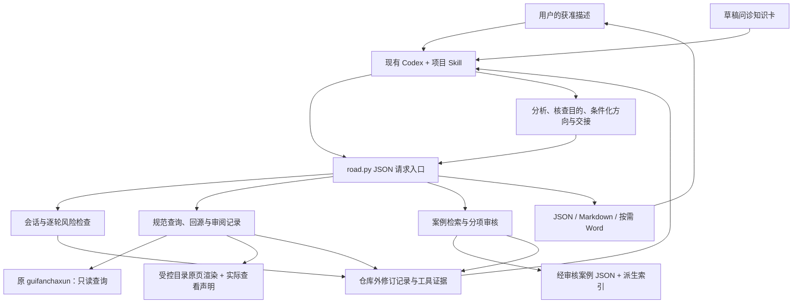

# 当前个人版架构

Codex 负责理解和分析，项目工具负责状态、约束与证据。没有独立模型服务、dsh 后台或产品页面。

## 目录入口

- `scripts/road.py`：JSON 请求入口；`scripts/check_*.py`：开发检查，命令与影响见 [交接验证表](交接.md#验证与交付)。
- `src/roadexpert/`：下列业务模块；`tests/`：对应回归，`tests/fixtures/synthetic/`：合成情境。
- `.agents/skills/road-diagnosis/`：唯一咨询技能及 `references/` 操作参考。
- `data/knowledge/`：草稿知识卡；`data/cases/`：真实案例与派生索引，允许空库。
- `config.example.json`：本机配置示例；真实咨询、证据、请求正文和导出存储在仓库外。

## 模块与边界

- storage.py：临时工作状态与按需保存档案，通过 retention 区分；24小时未写入的临时状态在后续调用清理，明确结束时即时清理；修订快照、指纹、版本检查、写锁和受控路径仍用于当次连续问诊。
- risk.py：五类无数值关注线索、否定／未知／历史／假设初筛；规则为草稿，宿主补结构化抽取。
- specs.py：固定操作与字面查询，不调用维护命令；原页在项目外部存储渲染。
- cases.py：JSON 单源、分项人工审核、撤回与查询时索引复核。
- service.py：多轮、证据关联、适用性声明、答案绑定；save 是显式长期归档，export 是显式导出，backup 只含主动保存的档案。默认不展示编号或保存流程。
- advice.py：分领域分析字段与三种交付格式的契约；不推断病因。专项导出只取最新且未过时的对应交付内容，共用来源、风险、规范核验与判断边界；原完整咨询导出继续可用。
- photos.py：用户获准附件的受控副本、元信息及实际查看声明；图片观察生成带定位的事实，照片变化使旧意见和规范适用性需重新核对。副本在咨询sessions目录，复用临时清理和主动保存备份，不保存或改写用户原图。
- comparison.py：有条件的方向比较与当前已知事实引用，不自动排序、评分或批准施工。比较进入聊天及按需文件。
- word_export.py／word_document.py：用户明确请求后通过本机文档Python生成可编辑Word，可选择附图；不附全历史JSON、不自动归档。文件生成采用临时文件完成后替换；宿主另作渲染及逐页核对，无网络与模型API。
- delivery_check.py：只读检查最新意见及所选交付范围；明确完整性错误、文字来源疑点与宿主语义核对分别输出。export锁定当前咨询并重查，可绑定检查内容指纹；历史导出需显式选择且标注非当前交付。Word临时文件中的嵌图字节及图注匹配要求后才替换目标文件，排版另验。不联网、不调用模型、不自动改写意见或作工程批准。

程序检查摘录定位、来源指纹、记录归属和字段状态，不能独立证明看图、专业审核身份或语义适用性。宿主的其他通用工具并不受此 CLI 全面约束。

`App.dispatch` 在每次操作前清理过期临时状态，包含 doctor 和 delivery-check；检查逻辑只读不代表整个调用无生命周期副作用。默认存储按项目绝对路径生成标识，迁移目录时需核对存储位置，不自动搬移。

普通完整咨询导出需通过最新意见有效性检查，但 JSON 仍保存全会话，Markdown／Word 可能包含续办与前次意见。专项导出按用途裁取；history_only 是历史用途标记，不承担脱敏功能。备份只含已保存咨询及关联资料。

依赖和配置见 [当前交接](交接.md#本机运行与换机注意)：照片使用 Pillow，原页渲染使用 PyMuPDF，Word 由独立文档 Python 及 python-docx／Pillow 生成。早期“标准库 CLI”描述不能理解为所有现有功能均无需外部依赖。

P3 再将现有输入输出接到 dsh 工具和应用服务，把必要关口纳入受控调用链，接最小页面。迁移复用知识、规则、案例与记录，模型／入口变化后重跑测试及专业评价。
